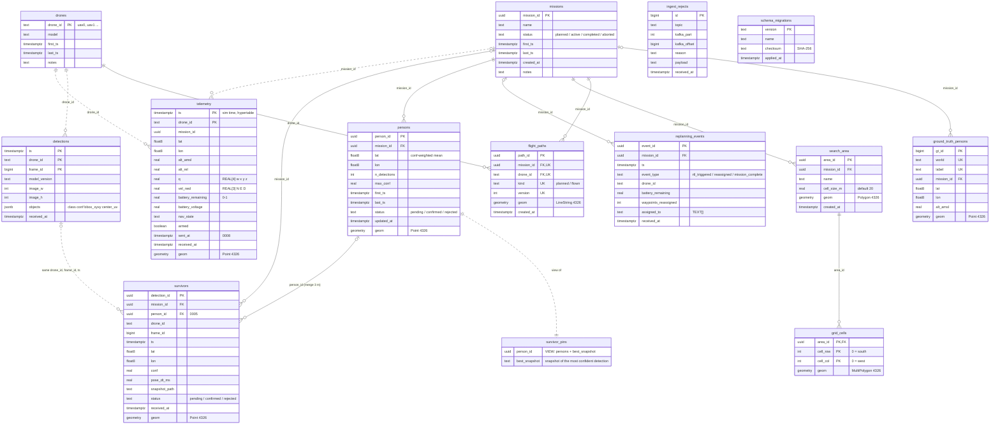

# Aquarius — ER Diagram

ตารางของ data pipeline ในฐานข้อมูล `aquarius` (PostgreSQL 17 + TimescaleDB + PostGIS) ตาม migration `0001`–`0008`
ใน `docker/db/migrations/` (19 พ.ย. 2026) รายละเอียดทุกคอลัมน์, ฟังก์ชัน และ index อยู่ใน
[`data_dictionary.md`](data_dictionary.md) ส่วนหน้าแบบ interactive อยู่ใน Claude artifact "Aquarius ER Diagram"

- **เส้นทึบ** = foreign key จริงในฐานข้อมูล
- **เส้นประ** = อ้างถึงกันจริง แต่ไม่มี constraint (`telemetry`, `detections` รับ 10 แถว/วินาทีต่อลำ จึงไม่มี FK
  ingestion สร้างแถวใน `missions` / `drones` ให้ก่อนเขียนแทน)
- ลบ mission แล้วตารางที่ผูกด้วย FK ถูกลบตาม (`ON DELETE CASCADE`) ยกเว้น `ground_truth_persons.mission_id` และ
  `survivors.person_id` ที่กลายเป็น NULL · `survivors.mission_id` และ `replanning_events.mission_id` เป็น FK
  แบบไม่ cascade (ลบ mission ไม่ได้ถ้ายังมีแถวอ้างอยู่)
- `geom` ทุกตัวเป็น EPSG:4326 สร้างจาก `lat` / `lon` อัตโนมัติ (generated) ระยะและพื้นที่คำนวณใน UTM (`aq_utm_srid`)

`ingest_rejects` และ `schema_migrations` เป็นตารางระบบ ไม่ผูกกับตารางอื่น

## ตารางที่ไม่ได้อยู่ในแผนภาพ

ตารางของ Telegraf (ทาง MAVLink → MQTT ของ zflukz ใช้กับ dashboard Fleet): `online`, `status`, `"position"`,
`attitude`, `battery`, `gps`, `health`, `mission`, `event` ไม่มีใน migration Telegraf สร้างเองตอนมีข้อมูลเข้า
ทุกตารางมี `time`, `fleet`, `drone` (`'0'`, `'1'` …), `received_at` + field ของ stream นั้น ลบหลัง `TSDB_RETENTION`
(30 วัน) และไม่ผูกกับตารางข้างบน คอลัมน์ครบอยู่ใน [`data_dictionary.md`](data_dictionary.md#ตาราง-telegraf-dashboard-fleet)
